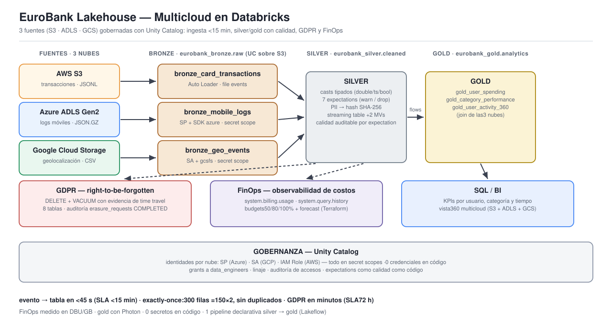
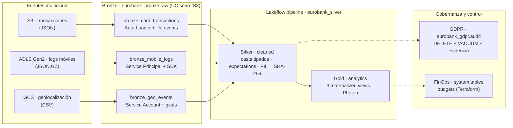

# EuroBank Lakehouse

**Plataforma de datos multicloud en Databricks** — AWS S3 · Azure ADLS Gen2 · Google Cloud Storage
gobernada con **Unity Catalog**: ingesta incremental con latencia de segundos, capas medallion
(bronze → silver → gold) con calidad como código, cumplimiento **GDPR** verificable y
observabilidad **FinOps** con system tables.


---

## Arquitectura





**Patrón clave:** Unity Catalog solo gobierna storage del mismo cloud que el workspace →
S3 se conecta con **external location nativa**; ADLS y GCS usan el patrón legacy documentado
(credenciales en *secret scopes* → lectura directa → materializar en tablas UC sobre S3).
*Bypass en lectura, gobernanza en escritura.*

---

## Capacidades y resultados

| Capacidad | Implementación | Resultado medido |
|---|---|---|
| **Latencia de ingesta** | Auto Loader en *file notification mode* (`cloudFiles.useManagedFileEvents=true`): eventos SNS→SQS, sin polling `LIST` | evento → tabla en **<45 s** (SLA: <15 min) |
| **Exactly-once** | Checkpoint en volumen UC (estado RocksDB) + JSONL como formato de origen | **300 filas =150×2, sin duplicados** |
| **Calidad de datos** | **7 expectations** en la pipeline (5 silver +2 gold) con política `warn`/`drop` + métricas auditables | datos inválidos fuera de gold y **contados** |
| **GDPR — right-to-be-forgotten** | Procedimiento de7 fases: mapa de PII → `DELETE` + `REFRESH` de MVs → retención `0 s` + `VACUUM` → evidencia con **time travel** antes/después → auditoría | borrado efectivo en **minutos** (SLA:72 h) · **8 tablas** purgadas |
| **Pseudonimización** | `SHA2(LOWER(email),256)` en silver | PII crudo confinado a bronze |
| **Seguridad** | Secret scopes en los3 clouds (SP / SA / IAM role), **0 credenciales en código** | PCI-DSS/GDPR-compliant |
| **FinOps** | Presupuestos con alertas50/80/100% + forecast (Terraform) · `system.billing.usage` · `system.query.history` | eficiencia medida en **DBU/GB**; gold con **Photon** verificable (`product_features.is_photon`) |

---

## Estructura del repositorio

```
├── 01_setup_and_connectivity/        # Terraform (buckets ADLS/GCS/S3 + budget Azure)
│   └── UNITY_CATALOG_S3_SETUP.md     # Runbook de conectividad S3↔UC (incl. troubleshooting9/9)
├── 02_bronze_ingestion/              # Notebooks de ingesta + generadores de datos
│   ├── SETUP.md                      # Prerrequisitos del notebook ADLS
│   ├── Auto Loader S3 - File Events.ipynb
│   ├── Azure ADLS Gen2 - Serverless Compatible.ipynb
│   ├── GCS Geo - Serverless Compatible.ipynb
│   └── data_samples/                 # Fixtures (JSONL · CSV · JSON.GZ)
├── 03_silver_dlt_pipeline/
│   ├── eurobank_silver_pipeline.sql  # Pipeline silver+gold (6 datasets,7 expectations)
│   └── DELTA_LIVE_TABLES.md          # Arquitectura de pipelines declarativas
├── 04_gold_analytics_photon/
│   └── README.md                     # Definiciones de gold (referencia a la pipeline)
├── 05_gdpr_compliance/
│   └── gdpr_right_to_be_forgotten.sql  # Procedimiento GDPR de7 fases con auditoría
└── 06_finops_governance/
    ├── FINOPS_REPORT.md              # Observabilidad de costos (system tables)
    └── main.tf                       # Presupuesto mensual + alertas multiumbral
```

## Stack tecnológico

| Categoría | Tecnología |
|---|---|
| Compute / orquestación | Databricks Serverless · **Lakeflow pipelines** (Spark Declarative Pipelines) · Auto Loader |
| Almacenamiento | Amazon S3 · Azure Data Lake Gen2 · Google Cloud Storage |
| Gobernanza | **Unity Catalog** · secret scopes · expectations (calidad como código) |
| Formato / tablas | **Delta Lake** (ACID, time travel, VACUUM, deletion vectors) · JSONL · CSV · JSON.GZ |
| Infraestructura como código | **Terraform** (presupuestos, storage) |
| Lenguajes | Python · SQL |

## Puesta en marcha

1. **Infraestructura** — `terraform apply` en `01_setup_and_connectivity/` (buckets + budget)
2. **Conectividad S3 ↔ Unity Catalog** — seguir [`01_setup_and_connectivity/UNITY_CATALOG_S3_SETUP.md`](01_setup_and_connectivity/UNITY_CATALOG_S3_SETUP.md)
   (storage credential → external location con file events → grants)
3. **Secretos** — [`02_bronze_ingestion/SETUP.md`](02_bronze_ingestion/SETUP.md) (scope `eurobank-secrets` +3 claves de Azure)
4. **Bronze** — ejecutar los3 notebooks de `02_bronze_ingestion/` en orden
5. **Silver + Gold** — ejecutar [`03_silver_dlt_pipeline/eurobank_silver_pipeline.sql`](03_silver_dlt_pipeline/eurobank_silver_pipeline.sql)
   (registrarlo como fuente de una pipeline Lakeflow con target `eurobank_silver.cleaned` / `eurobank_gold.analytics`)
6. **GDPR** — [`05_gdpr_compliance/gdpr_right_to_be_forgotten.sql`](05_gdpr_compliance/gdpr_right_to_be_forgotten.sql)
7. **FinOps** — [`06_finops_governance/FINOPS_REPORT.md`](06_finops_governance/FINOPS_REPORT.md)

## Documentación

| Documento | Contenido |
|---|---|
| [`UNITY_CATALOG_S3_SETUP.md`](01_setup_and_connectivity/UNITY_CATALOG_S3_SETUP.md) | Runbook completo S3↔UC: IAM trust/permission policy, file events, grants, tabla de errores y soluciones |
| [`DELTA_LIVE_TABLES.md`](03_silver_dlt_pipeline/DELTA_LIVE_TABLES.md) | Arquitectura de pipelines declarativas (control plane, flows, expectations) |
| [`FINOPS_REPORT.md`](06_finops_governance/FINOPS_REPORT.md) | Métricas de costos/uso con system tables y estrategia de presupuestos |
| [`gdpr_right_to_be_forgotten.sql`](05_gdpr_compliance/gdpr_right_to_be_forgotten.sql) | Procedimiento GDPR auditable (evidencia con time travel + VACUUM) |

> **Nota sobre los datos:** los fixtures de `02_bronze_ingestion/data_samples/` se generan con
> los scripts `generate_*.py` del mismo directorio (datos sintéticos, sin información real).
